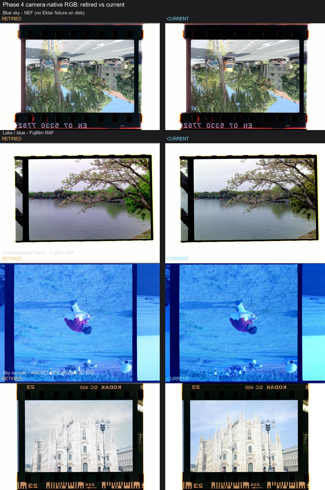

# Phase 4：相机原生 RGB 反相集成报告

- 日期：2026-11-12
- 基线：`v1.2-clean-baseline.1`（本地 `main @ 9ff7a39`；与云端 `origin/main @ fe8ebde` 已同步，本地只领先提交）
- 集成分支：`integrate/camera-native-rgb`
- 范围：PR #12 的色彩部分，取代 #10 / #12 的相机 RAW 反相主体

## 一、同步与来源

云端 `origin/main` 已是本地 `main` 的祖先；本地 Phase 3.2.1 和云端网站文档均已在当前基线中。仓库原先没有 `v1.2-clean-baseline.1` 标签，本次在 `main @ 9ff7a39` 创建了本地轻量标签。

集成分支包含以下作者提交，Author 均保留为 `jacky_tan <1979980670@qq.com>`：

| 提交 | 内容 | 处理 |
|---|---|---|
| `ec7f888` | `blue_channel_diagnostic` | cherry-pick `8c3016a` |
| `b0b8fb8` | 相机原生 RGB 反相主体 | cherry-pick `b7fb6b9` |
| `6cbd59d` | RAW 预览占位图转正 | cherry-pick `4f8864d`；`384b89d` 只覆盖检测缩略图，不覆盖 UI 占位图 |

后续补强：

| 提交 | 内容 |
|---|---|
| `cb90ad8` | 拒绝持久化 identity/unresolved 矩阵；CPU/WebGL parity fixture；Roll 锚点 basis 拒绝提示；fixture sweep / sky 诊断 |
| `f3f81d2` | `data_process_pipeline_doc.md`、`unified-density-pipeline.md`、中英 handbook 色彩科学章节 |
| `0aebab0` | 3.2.1 遗留：自动内缩按检测框朝向 |
| `74c089a` | 取 #10 `090e65f` 与 main 的并集：补齐 `CHROME_PATH`，保留已有 macOS 路径 |

未取：

- `a4d5c68`、`9eb4f90`：检测框方向化与 3.2.1 的方向化实现重复；4f 依赖的 `read_raw_tiff_orientation` 只作为最小冲突适配补入。
- `b801d2d`、`784fe82`：网络检测器不在 Phase 4；评测结论见第六节。

## 二、#10 与 #12 主体差异

直接执行 `git diff e13f05a b7fb6b9` 会看到 39 个文件、约 `+13,833/-154`，其中绝大多数来自两者不同的基线：`e13f05a` 基于旧的 `909251c`，`b7fb6b9` rebase 在 `e07ff1e` 上，后者已包含 dual-source RAW、导出只读、Film Area 等大量改动。因此逐行直接 diff 不能用来判断作者是否丢改动。

用 `git range-diff e13f05a^..e13f05a b7fb6b9^..b7fb6b9` 对主体补丁比较后，两版的核心语义一致；b7 的差异都是 rebase 到较新 main 的适配，不是删除或改写色彩方案：

1. `decode_scanner_profiled_estimate_with_matrix` 改为同时返回工作缓冲区和 `camera_to_display`；e13 的旧基线中该信息由相邻路径分别传递。DNG、TIFF、扫描仪的 `(image, None)` 分支随之调整。
2. 导出路径在 b7 中增加 `render_pipeline_state.processing_report.camera_to_display = camera_to_display`，与当前“导出解码不再回写测量”的只读路径合并。
3. UI 适配了当前已有的 `currentProxyDomain` 解析顺序，不覆盖后续加入的帧切换状态提交。
4. 测试所在模块从 `input_domain_round_trip_tests` 调整到 `repro_unknown_camera_tests` 附近，内容未丢失。
5. b7 保留 working-basis resolver 门、Flag 8、`u_positive_to_display`、`DENSITY_WINDOW_RULE_VERSION 3→4` 和 `RAW_DECODE_VERSION` 不升的全部主体逻辑。

## 三、冲突与解决

| 文件 | 冲突 | 解决 |
|---|---|---|
| `src/commands.rs` | 解码函数注释与诊断入口 | 保留当前 Phase 3.1 的 decode-route 诊断，并把函数注释改成“相机 RAW 为 camera-native，其余为 ProPhoto” |
| `src/commands.rs` | 文件末尾两个测试模块 | 保留 Phase 3.1 的只读导出测试，再加入相机原生测试；两边都带 `#[cfg(test)]` |
| `src/main.rs` | Tauri 命令注册 | 同时保留 `auto_detect_film_border_batch` 和 `get_source_orientation` |
| `src/commands.rs` | 4f 依赖未取的 9eb 的 `read_raw_tiff_orientation` | 补入最小 IFD0 orientation helper；不取检测框方向变换 |
| `src/commands.rs` | `PipelineResolverInput` 新字段 | 给三个测试构造器补 `working_basis: default()` |

约束核对：

- 矩阵、domain、base、纹理一起进入同一条解码/持久化链；不存在只更新矩阵不更新端点的路径。
- `camera_to_display` 只有有限、非退化且不是 identity/unresolved 时才写入；旧记录缺字段读作 `None`。
- M2（LibRaw 解包失败后 rawler 像素回退）仍走 CameraNative 密度基。
- `DENSITY_WINDOW_RULE_VERSION = 4`；`RAW_DECODE_VERSION = 13`。

## 四、Fixture sweep

非相机输入、DNG 和扫描 FFF 使用同一 `test_picture` 夹具，在 baseline.1 与集成分支各跑一次固定全画幅分析/渲染，比较输出 `Rgb<u16>` 的 SHA-256 和尺寸。

- 覆盖：74 帧（17 JPEG + 30 TIFF + 24 DNG + 3 扫描 FFF）。
- 结果：74 / 74 逐字节一致，0 个缺失。
- 两个 `.xmp` 不是图像，跳过。
- 相机 RAW 共 57 帧（40 NEF + 13 RAF + 1 ARW + 3 相机 FFF）；57 / 57 如预期发生变化，逐条见下表。

相机 RAW 逐文件变化（retired / current 为渲染字节 SHA-256 前 12 位）

| fixture | retired | current |
|---|---|---|
| DSCF0895.RAF | 095abf8665ff | 2e0d0a731312 |
| PFCS001.raf | 7e15cea2d31d | cdfb11ec4d90 |
| 哈苏fff/任务 _0866.fff | 1e50a04fbaa7 | 54dc96217732 |
| 哈苏fff/任务 _1233.fff | f527279c3d16 | 93b4e532b8bf |
| 哈苏fff/任务 _1343.fff | 5b8ff80464c0 | 92e4c2b19e44 |
| 天空发白/4000363.ARW | d363f2a1641c | e26a269829ff |
| 富士raf/Capture One Catalog1942.raf | c5c193eb6709 | 62deca8c0162 |
| 富士raf/Capture One Catalog1943.raf | cb8b103d81e0 | c232401248c3 |
| 富士raf/Capture One Catalog1944.raf | 2108d8b918db | d46fc7843eec |
| 富士raf/Capture One Catalog1945.raf | 035f5fd3df75 | 17642aaa8067 |
| 富士raf/Capture One Catalog1946.raf | 198b9f681d05 | 7266a3d40ce8 |
| 富士raf/Capture One Catalog1947.raf | 541a86f8b54f | 29b93ccbcbe2 |
| 富士raf/Capture One Catalog1948.raf | 7137436e201d | 1f7cb80a04f3 |
| 富士raf/Capture One Catalog1949.raf | 4d6e52037fc1 | 0351be321588 |
| 富士raf/Capture One Catalog1950.raf | 4949651d2113 | 081deded8ebe |
| 富士raf/Capture One Catalog1951.raf | ec7c6fb26959 | 2105928fb291 |
| 富士raf/Capture One Catalog1952.raf | 6a5f0af39b86 | 1db45203ac77 |
| 尼康nef_raw/_DSC7333.NEF | 9027c1375f62 | af8cde773488 |
| 尼康nef_raw/_DSC7334.NEF | 418422e401c5 | 31a19d15b3b9 |
| 尼康nef_raw/_DSC7335.NEF | 00133e2ed022 | 4c72484d5f78 |
| 尼康nef_raw/_DSC7336.NEF | 3661af2741b2 | da546297cb3b |
| 尼康nef_raw/_DSC7337.NEF | e1e8e6a3d835 | 4b92c707f1f8 |
| 尼康nef_raw/_DSC7338.NEF | c7f691fa3022 | 87926d7f8540 |
| 尼康nef_raw/_DSC7339.NEF | 75d4a9b73d21 | 4b520aa079a7 |
| 尼康nef_raw/_DSC7340.NEF | 1796b62019db | 2a94a287a922 |
| 尼康nef_raw/_DSC7341.NEF | 0cabeae09c1d | 959584f2a66d |
| 尼康nef_raw/_DSC7342.NEF | 7ea699bac58f | 64a6f374454d |
| 尼康nef_raw/_DSC7343.NEF | a9370e9ec9b0 | 99b24be14f0b |
| 尼康nef_raw/_DSC7344.NEF | 51c144624541 | 2899771ee197 |
| 尼康nef_raw/_DSC7345.NEF | 5543accff9de | 2fdfb6efa6f6 |
| 尼康nef_raw/_DSC7346.NEF | a6ac3e814621 | 8fe07efee945 |
| 尼康nef_raw/_DSC7347.NEF | 5068c3de7452 | 46e095615599 |
| 尼康nef_raw/_DSC7348.NEF | 30c1869bdee8 | f24c49f46798 |
| 尼康nef_raw/_DSC7349.NEF | 51498983ece0 | b085055f4192 |
| 尼康nef_raw/_DSC7350.NEF | af3a6a44bf23 | 94e74d26fa24 |
| 尼康nef_raw/_DSC7351.NEF | 866d3999c268 | 4d2f1a3dc5c4 |
| 尼康nef_raw/_DSC7352.NEF | 8f6204fbe46e | 49190947e030 |
| 尼康nef_raw/_DSC7353.NEF | 73a3e8d04e9e | 4d687ebf4b6f |
| 尼康nef_raw/_DSC7354.NEF | 084bc7227b49 | 0309f55ee6f8 |
| 尼康nef_raw/_DSC7355.NEF | 4129b6a5305a | 143f5d866c2d |
| 尼康nef_raw/_DSC7356.NEF | 341910a7e734 | 7663f61e1ab3 |
| 尼康nef_raw/_DSC7357.NEF | 6d245be5ffa1 | 0d3f85343859 |
| 尼康nef_raw/_DSC7358.NEF | 8c2b7f917ce8 | d8f0f30e44bf |
| 尼康nef_raw/_DSC7359.NEF | 426418bf7d03 | 14fbd4b91815 |
| 尼康nef_raw/_DSC7360.NEF | 76dda177960b | 36a96fa5d02c |
| 尼康nef_raw/_DSC7361.NEF | 4c238c746714 | bed25faa860d |
| 尼康nef_raw/_DSC7362.NEF | 236a2b640ccb | 0819bdc05cae |
| 尼康nef_raw/_DSC7363.NEF | 84fc489f68ac | 46f447fff119 |
| 尼康nef_raw/_DSC7364.NEF | 7b4c03c362ea | 392145bd3943 |
| 尼康nef_raw/_DSC7365.NEF | d298091afd15 | 9de49710f411 |
| 尼康nef_raw/_DSC7366.NEF | f55094538be7 | 3f6887ec0371 |
| 尼康nef_raw/_DSC7367.NEF | 19fc5e8d494e | ffe7523e9360 |
| 尼康nef_raw/_DSC7368.NEF | 4a789d9f959a | bf2defe53f01 |
| 尼康nef_raw/_DSC7369.NEF | b91ada4628c3 | 1191d0ce0e81 |
| 尼康nef_raw/_DSC7370.NEF | 177ecc836140 | 71e2cd548f6f |
| 尼康nef_raw/_DSC7371.NEF | 75934367ef4e | 11295f25bfbd |
| 尼康nef_raw/_DSC7372.NEF | a30cf0a5ff9c | bbd5cb43470e |

完整 JSON：`target/fixture-sweep/non-camera-phase4-v3.json`、`target/fixture-sweep/camera-raw-phase4.json`。

## 五、RAW 肉眼 A/B 与天空数据

本地 `test_picture` 中没有 Ektar 卷或 Ektar 标号；最接近的蓝天相机样张是 `_DSC7333.NEF`（数据库标为 Kodak 5207 250D），另用 `DSCF0895.RAF` 的湖水/蓝调场景补充。欠曝样张使用 `Capture One Catalog1949.raf`，天空样张为指定的 `4000363.ARW`（Kodak GC 400）。

`4000363.ARW` 的天空 ROI：全图归一化 `x=0.15..0.84`、`y=0.16..0.30`，避开建筑与片边。

| 路径 | 任一通道 ≥0.995 | ROI 均值 B/G |
|---|---:|---:|
| retired（ProPhoto + gamut compression） | 0.47% | 1.0297 |
| current（camera-native） | **28.46%** | **1.1268** |

结论：**B/G > 1 通过，但高光触顶比例未达到 <1% 的 Phase 4 验收线**。按路线图要求，本阶段不调参，数据交 Phase 5。相机原生路径恢复了天空的蓝色（A/B 图中由灰白变为蓝），但白色大教堂和云层仍把 ROI 统计推到 28.46%。

## 六、3.2.1 遗留：按检测框朝向内缩

自动内缩从“图像水平 1% / 垂直 2%”改为按检测框自身长边方向：长边两侧 2%、短边两侧 1%，倾斜框通过相邻偏移边线求交。近方形（纵横比 < 1.05）保留旧横框规则，避免全幅/全景扫描在一像素差异上翻转。

重跑 `film_area_eval`（`results-phase4-oriented-inset-r3.json`）：

| 场景 | 角点 | 漏光帧 | 三尺寸一致 |
|---|---:|---:|---:|
| 3.2.1 | 0.1782 | 50 | 175 / 191 |
| Phase 4 收尾 | **0.17806** | **48** | **175 / 191** |

冷启动三项未回退。留一法、前 1、前 3 分别为 `0.07146 / 22 / 187`、`0.05571 / 35 / 186`、`0.05814 / 31 / 186`。

## 七、回归

- `cargo fmt --all -- --check`：通过。
- `cargo test --lib`：312 passed / 0 failed / 27 ignored。
- `node --test ui/*.test.js`：19 passed / 0 failed。
- 根目录 `scripts/verify-*.cjs`：15 个脚本全部通过，包括中英 handbook 同步与 WebGL shader 编译。
- `cargo test --lib cpu_render_fixture_for_webgl_parity -- --ignored` + `node scripts/diagnose-cpu-webgl-parity.cjs`：CPU/WebGL 最大通道差 0.0029，低于 0.02 容差；fixture 使用相机矩阵并显式设置 `u_positive_to_display`。
- `cargo test --test film_area_eval -- --ignored`：191 帧全跑，结果见上。

## 八、检测器评测结论

PR #12 的检测器在独立 worktree 中用同一批 191 帧、同一方向化输入评测：

- 冷启动角点 `0.1349`，比 3.2.1 的 `0.1782` 更准；
- 冷启动漏光 `84` 帧，比 3.2.1 的 `50` 帧更多；
- 先验漏光 `44`，比 3.2.1 的 `24` 更多；
- 三尺寸一致 `186 / 191`，比 3.2.1 的 `175 / 191` 更好。

结论：角点更准，但漏光回退。Phase 4 不合并检测器；训练数据不在仓库，`tools/film_gate_model/train.py` 依赖外部 `<work>/labels/FROZEN.json` 和 `manifest.json`，当前无法审计来源与再分发授权。作为 v1.3 的候选，只用于候选筛选，需作者补齐训练数据来源和授权后再评估。

## 九、Supersedes #10 and #12（PR 文案）

### Supersedes #10 and #12: camera-native RGB inversion

This PR integrates the colour work originally contributed by **@jacky_tan** in #10 and #12, rebased onto the current Phase 3.2.1 / website baseline.

Credit:

- Thank you to @jacky_tan for the camera-native RGB inversion, the display-matrix transport, and the diagnostic work.
- The integration preserves the author commits. Conflict adaptations, guardrails, documentation, and the 3.2.1 inset fix are separate follow-up commits.

What changed:

- LibRaw camera RAWs run the density stage in NormalizedAsShot Camera Native RGB; DNG, scanner FFF, TIFF, and JPEG keep the ProPhoto Estimate path.
- The per-frame camera→sRGB matrix is persisted only when valid, transported with the proxy (header flag 8), and applied after the positive is normalized through `u_positive_to_display` in both WebGL passes and the CPU renderer.
- Identity/unresolved matrices are never persisted. M1/M2 camera-native paths use the same basis.
- Roll anchors record their working basis; cross-basis anchors are rejected with a readable UI message.
- `DENSITY_WINDOW_RULE_VERSION` is 4; `RAW_DECODE_VERSION` remains 13.
- Automatic Film Area inset now follows the detected box's long edge, fixing rotated portrait frames.

Validation:

- 74/74 non-camera/DNG/scanner-FFF fixtures are byte-identical to the baseline; all 57 camera RAW fixtures change as expected and are listed in `docs/v1.2-phase4-camera-native-rgb.md`.
- RAW A/B panels are included in the report.
- `4000363.ARW` sky B/G = 1.1268 (>1), but 28.46% of the sky ROI still hits ≥0.995. The highlight-clipping target is not met; the data is handed to Phase 5 without tuning here.
- Detector evaluation: corners are more accurate (`0.1349` vs `0.1782`), but cold-start leakage is worse (`84` vs `50` frames). The detector is not part of Phase 4.
- Before considering the detector for v1.3 candidate screening, please provide the training-data sources and redistribution authorization for the weights/data. The repository does not contain the training images or labels, and no separate model/data license is recorded.

This PR supersedes the colour scope of #10 and #12. The detector changes remain a v1.3 candidate only; merging and closing #10 / #12 are left to the maintainers.
