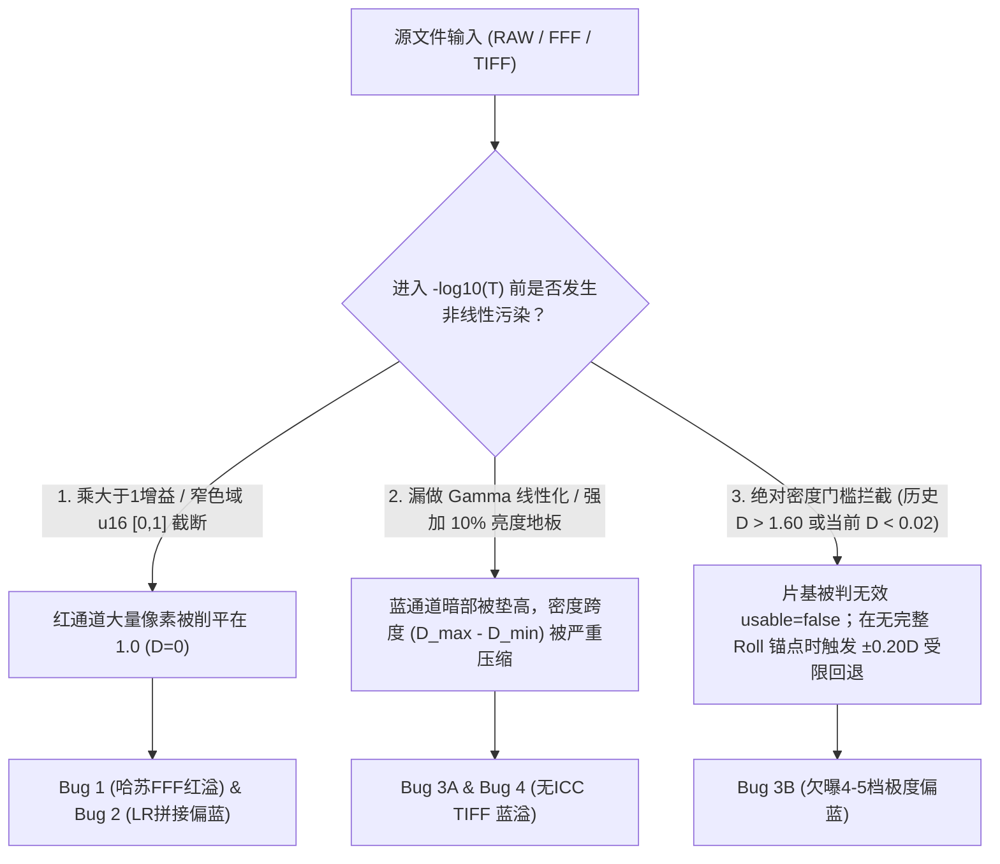
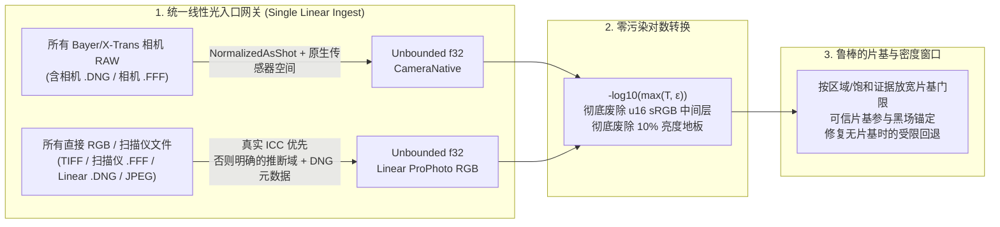

这是一份针对 Nexfilm 源文件预处理与密度反相管线的深度调查报告。

为了便于核对，我把色彩矩阵和底层代码翻译成了**物理直觉 + 架构因果**，并给出相对当前 `HEAD = f32bc17` 的关键函数位置。行号只用于定位，最终以函数名和调用链为准。

---

## 核心结论先行（TL;DR）

你的方向基本正确：**之前修过的四个典型 Bug（哈苏 FFF 红色溢出、LR 拼接极度偏蓝、欠曝 4–5 档极度偏蓝、无 ICC TIFF 蓝色溢出）中，大多数共享“对数前输入污染”，但欠曝案例还叠加了独立的片基阈值问题。**

这个更大的底层问题可以总结为三句话：

1. **核心数学前提被破坏（对数前的“污染”）**：
   在线性光下，整体曝光、快门或通道增益可以写成 $k_c T_c$；取 $-\log_{10}$ 后会变成固定偏移，并在片基扣除和端点归一化中抵消。这个性质成立的前提是：**没有逐像素截断、没有把编码值当线性值、片基也在同一色彩域测量**。通道相关增益若再经过跨通道矩阵，简单的一维偏移模型就不再成立；矩阵后再截断或垫底会进一步破坏通道比例。
   因此，真正危险的是以下组合，而不是“矩阵”本身：
   - **非线性（Gamma 未解开或被当成线性）**
   - **硬截断或人为垫底（`u16 [0, 1]` 截断、或者对蓝通道强加 `10%` 亮度地板）**
   - **通道相关增益进入跨通道矩阵后，又在进入 $\log$ 前发生截断/垫底**
2. **解码入口“碎片化”（修一处漏三处）**：
   Nexfilm 没有一个统一的“线性光入口网关”，而是按“文件后缀 + 相机/扫描仪类型 + 预览/导出”写出了 **6 条以上各自为战的解码分支**。之前每次修 Bug，都是在某一条分支上打补丁，而其它分支（甚至同一张图在“画布预览”与“导出”之间）还保留着旧逻辑。
3. **自动片基与密度归一化的“全或无（All-or-Nothing）悬崖”**：
   在 [commands.rs](file:///e:/Code/NegativeConverter/src/commands.rs) 的自动片基验证与密度拉伸中，存在**写死的绝对密度阈值**和**片基自我抵消悖论**。片基因欠曝、向右曝光（ETTR）或边框不足被判为 `usable = false` 后，在没有完整 Roll 全曝光锚点的路径上，程序会退回 [`share_smart_auto_density_scale`](file:///e:/Code/NegativeConverter/src/commands.rs#L2962-L2998)——它把三通道的密度偏移限制在 `±0.20 D` 以内。彩色负片的橙色色罩跨度通常明显大于这个值，因此最坏情况下会出现严重偏蓝/青色；是否达到“极度深蓝”仍取决于色罩幅度和画面内容，不能表述为 100% 必然发生。

更重要的是：经过对当前 `v1.2.1`（`HEAD = f32bc17`）关键路径的排查，整理出了 **7 个高风险点**（包括相机 `.dng`、扫描仪 `.fff`、向右曝光 ETTR 底片、非标 ICC 命名等）。其中前 4 项有明确的当前代码证据；第 5、7 项需要限定条件；第 6 项的数学结论成立，但原描述中的函数和实现细节需要修正。

下面我们分五部分展开。

---

## 第一部分：为什么你的 D810 流程很少触发这些问题？

你用 Nikon D810 翻拍之所以稳定，是因为工作流主要落在被反复验证的 RAW 主路径上，避开了当前已识别的多数边界分支：

| 维度 | 你的 D810 黄金工况 | 用户的真实边界工况 |
| :--- | :--- | :--- |
| **文件容器与后缀** | `.NEF` 原生相机 RAW，直走 LibRaw 主路径，不经过 TIFF / DNG / FFF 分支判断 | `.tif`（LR 拼接、扫描仪、无 ICC）、`.fff`（哈苏后背或 Flextight 扫描仪）、`.dng`（徕卡/宾得/大疆/转码 DNG） |
| **色彩工作空间** | 在 Phase 4 (`b0b8fb8`) 后直走 `WorkingBasis::CameraNative`，不乘 `camera_to_srgb`，不过 `u16 sRGB` 中间层 | 掉入 `ProPhotoEstimate` 或旧版 `u16 linear-sRGB` 路径，触发色域截断或 `10%` 蓝通道亮度地板 |
| **曝光落点** | 曝光标准（0 EV 附近），片基密度稳稳落在 `0.35 ~ 0.90 D` 的“舒适区” | 欠曝 4–5 档（片基密度飙到 `1.7 ~ 2.4 D`）或向右曝光 ETTR / 扫描仪白平衡后（红通道透射率高于 95.5%；更靠右时还会先被 `0.98` 采样上限排除） |
| **构图与边框** | 翻拍留有干净的片基边缘，自动片基检测通常能成功 | 裁切严丝合缝无片基、片基过亮/过暗被拒、或者画面带有一圈浅色灯箱漏光 |

换句话说：Nexfilm 的核心反相算法在“干净的线性光 + 合理的密度窗口”下表现稳定；多数历史偏色来自非标源文件进入核心算法前的处理，但**片基验证与密度窗口是独立的第二类问题**。只修统一入口并不能解决 ETTR 误杀或片基自我抵消。

---

## 第二部分：四个历史 Bug 的反复机制——输入污染是主线，片基闸门是第二层

把这四个已经修掉的 Bug 放在一起看，前三个和第四个的主要偏色机制高度相似，都发生在对数转换前或片基扣除前后；但欠曝 4–5 档这一例还叠加了一个独立的片基绝对上限问题，不能全部归为同一行代码。

先看核心物理公式。对于彩色负片，胶片透射率 $T_c$（线性光读数）与密度 $D_c$ 的关系是：

$$D_c = -\log_{10}(T_c) - D_{\text{base}, c}$$

在 Smart Auto 的 f32 路径中，软件随后用共址样本的低端 2% 与高端 2% 尾部估计端点（$D_{\min, c}, D_{\max, c}$），将净密度归一化为 `[0, 1]` 的正片信号：

$$P_c = \frac{D_c - D_{\min, c}}{D_{\max, c} - D_{\min, c}}$$

请注意这个公式有多美妙：**如果因为欠曝、光源颜色、相机增益导致某个通道的线性光变成了 $k_c \cdot T_c$**，那么取完对数后：

$$-\log_{10}(k_c \cdot T_c) = -\log_{10}(T_c) - \log_{10}(k_c)$$

原本乘在每个像素上的系数 $k_c$，变成了一个固定的常数偏移 $-\log_{10}(k_c)$。只要没有截断、端点也随同一个偏移移动，计算分子和分母时这个常数偏移就会被抵消。

**那为什么我们还会遇到严重的红溢、蓝溢和偏蓝？** 因为大部分历史 Bug 破坏了这个抵消成立的前提；欠曝案例还额外命中了片基候选的绝对阈值。

下图描述的是历史 Bug 的共同机制，不代表当前每个输入分支都仍完整保留这些缺陷：



### 1. 哈苏 FFF 红色溢出（Bug 1）—— 对数前的“高位截断”
- **表面现象**：哈苏相机/后背拍的 `.fff` 反相后高光/暗部大面积死红溢出。
- **深层病因**：
  1. **同名不同命**：`.fff` 既是哈苏 Imacon/Flextight 扫描仪的格式（里面装的是已做过 Gamma 的 RGB TIFF），又是哈苏 CFV/X 系列数码后背的格式（里面装的是未去马赛克的线性 Bayer RAW）。早期代码把两者混为一谈。
  2. **进 $\log$ 前红通道被砍头**：彩色负片有浓重的橙色片基，透射光里**红光最强、蓝光最弱**（$T_R \gg T_G \gg T_B$）。早期调用 LibRaw 时设置了 `use_camera_wb = 0`，以为这样就是“关掉白平衡”，结果 LibRaw 在 `use_camera_wb = 0` 时会退回使用固定的日光 `pre_mul` 倍增系数（大于 `1.0`），并乘以 `camera_to_srgb` 矩阵写入无符号 `u16`（上限 `65535`）。
  3. 本来就最亮的红通道被乘上一个大于 1 的数，直接导致 **28.73% 的红通道像素撞上 `65535`（`1.0`）天花板被削平**。进入 $-\log_{10}(T)$ 后，这些像素的红通道密度全部归零，归一化分母崩溃，产生严重红溢。

### 2. LR 拼接全景极度偏蓝（Bug 2）—— 中间层 `u16 sRGB` 的“色域截断”与双路径分叉
- **表面现象**：Lightroom 拼接导出的 `.tif`（如 `_DSC7583-Pano.tif`）导入后整个画面变成诡异的深蓝/青色；历史诊断中 `B/G` 可达到约 `2.3`。
- **深层病因**：
  1. **用小杯子装大杯子的水**：LR 导出的拼接 TIFF 嵌入的是 **Adobe RGB (1998)** 广色域 ICC。负片高饱和的橙色片基（在 Adobe RGB 下为 `[0.993, 0.792, 0.707]`）超出了 sRGB 的色域边界。
  2. **中间层截断**：当时的 TIFF 解码器先把所有图片转换到 **`u16 linear-sRGB`** 缓冲区并执行 `.clamp(0.0, 1.0)`，然后再转去 ProPhoto 算对数。这一步把 Adobe RGB 转到 sRGB 时产生的大于 `1.0` 的红通道数值直接一刀砍平——源文件里原本只有 **0.95%** 的红通道触顶，经过这个 `u16 sRGB` 中间层后，**高达 84.7% 的红通道像素被截断为 `1.0`！**
  3. **画布与导出各走各的路**：在 `35c95db` 为画布（`prepare_proxy`）新增了直通 ProPhoto `f32` 的解码函数后，**导出路径（`decode_scanner_profiled_estimate_image_buffer`）当时被遗漏**，继续走旧的 `u16 linear-sRGB` 截断路径，导致画布修好后导出依然偏蓝。普通 TIFF 的这条分叉已在 `f32bc17` 中统一；当前残留的同类风险主要在相机 DNG 的预览/导出分叉、扫描仪 FFF 和绑定扫描仪 Profile 的路径上。

### 3. 欠曝 4–5 档照片极度偏蓝（Bug 3）—— “10% 人为垫底” + “1.60 D 绝对门槛误杀”
- **表面现象**：相机翻拍时如果欠曝 4–5 档（如 `Capture One Catalog1949.raf`），反相后画面彻底变成深蓝色，且暗部颗粒全是蓝紫色块。
- **深层病因**（双重暴击）：
  1. **第一重（对数前的 10% 亮度地板）**：在 Phase 4 (`b0b8fb8`) 之前，相机 RAW 会先乘 `camera_to_srgb` 矩阵（其蓝通道行含有 `-0.40 * G` 的大负数项），为了防止负数进 $-\log_{10}$ 报错，代码在 [`compress_linear_srgb_for_density`](file:///e:/Code/NegativeConverter/src/color_science.rs#L443-L483) 里写了一个看似安全的保护：**强行把任何低于该像素亮度 `10%`（`CHROMA_FLOOR_RATIO = 0.10`）的通道垫高到亮度的 `10%`**。但在橙色片基下，蓝通道的真实透射率本来就不到红绿通道的 `10%`！结果整张底片的蓝通道全被这 `10%` 的地板托住了，真实的蓝色密度细节被抹平，蓝通道分母 `(d_max - d_min)` 缩水，增益暴涨。
  2. **第二重（`FILM_BASE_MAX_DENSITY = 1.60` 绝对门槛误杀）**：翻拍时欠曝 4–5 档，意味着透射光 $T$ 整体缩小了 $16 \sim 32$ 倍。反映在对数密度 $D = -\log_{10}(T)$ 上，就是**所有通道的绝对密度整体向上平移了 $+1.2 \sim +1.5\text{ D}$**（片基从正常的 `0.5 D` 平移到了 `1.68 ~ 2.45 D`）。按理说，这只是一个常数平移，减掉片基就完事了！但历史版本的 `validate_film_base_candidate` 写死了 `FILM_BASE_MAX_DENSITY = 1.60`；该上限已在 `ea17647` 中删除，当前文件只保留了下限。它当时看到片基密度 `2.45 > 1.60`，判定**“片基无效”**，把 `base_density` 清零为 `[0, 0, 0]`，并把图片送进当前仍存在的 [`share_smart_auto_density_scale`](file:///e:/Code/NegativeConverter/src/commands.rs#L2962-L2998)。该函数只允许通道间最多偏移 `±0.20 D`，消不掉 `0.77 D` 的橙色色罩，最终出现严重蓝偏。

### 4. 1.2.1 刚修好的无 ICC TIFF 蓝色溢出（Bug 4）—— 漏解 Gamma 叠加 10% 地板
- **表面现象**：没有嵌入 ICC 配置文件的普通 TIFF 导入后发生严重的蓝色溢出（刚在 `f32bc17` 修复）。
- **深层病因**：
  1. 在 `f32bc17` 之前，带 ICC 的 TIFF 走 ProPhoto 直通函数，无 ICC 的 TIFF 则退回旧函数 `decode_reduced_tiff_for_working_space`。当前普通 TIFF 已统一走 `decode_direct_rgb_prophoto_estimate`，下面描述的是被修复前的历史路径。
  2. 旧函数调用了 [`convert_linear_image_in_place(image, SRgb, SRgb)`](file:///e:/Code/NegativeConverter/src/commands.rs#L4027-L4050)。这个函数第一行是 `if source == target { return image; }`——**它以为输入已经是线性的，跳过了 sRGB Gamma 2.2 解码（EOTF）。**
  3. 紧接着，它又调用了 [`linear_srgb_u16_to_prophoto_f32`](file:///e:/Code/NegativeConverter/src/commands.rs#L2597-L2614)，里面再次执行了 [`compress_linear_srgb_for_density`](file:///e:/Code/NegativeConverter/src/color_science.rs#L443-L483)（10% 亮度地板）。
  4. **把 Gamma 2.2 的非线性数据当成线性光送进 $-\log_{10}$，还垫了 10% 地板**：在 Gamma 2.2 下，暗部数值被抬高了（比如线性 `0.01` 在 Gamma 2.2 下是 `0.135`）。这导致蓝通道的对数密度窗口 `[d_min, d_max]` 被极度压缩，分母变小，归一化时蓝通道被疯狂放大，造成蓝色溢出。

---

## 第三部分：深度代码体检——当前 1.2.1 (`f32bc17`) 的 7 个高风险点

既然我们已经看清了病根，现在拿着放大镜去审视当前 `v1.2.1`（`f32bc17`）的代码，看看**还有哪些地方仍在重复这几类错误**。下面 7 项的风险程度并不相同：前 4 项可以直接从当前调用链确认；第 5、7 项需要限定触发条件；第 6 项的核心问题成立，但不能沿用原文中不存在的函数名和不准确的“完全抵消”表述。

---

### 💣 地雷 1：所有相机 `.DNG` 文件被排除在 `CameraNative` 之外，不仅仍在跑已被废弃的“10% 亮度地板”，而且“画布预览”与“导出”走的是两条不同路径！

这是目前最危险的一颗雷。什么用户会导入相机 `.dng`？
- 徕卡（Leica）、宾得（Pentax）、理光（GR）、大疆（DJI）、适马（Sigma）、手机 RAW 翻拍用户；
- LR / Capture One / Adobe DNG Converter 导出的 DNG 用户；
- **最讽刺的是：当 Nikon Z8/Z9/Zf 用户导入高效率压缩 `.NEF`（HE / HE*）时，Nexfilm 自己的报错弹窗明确引导用户“请先用 Adobe DNG Converter 转为 `.dng` 再导入”！**

然而，当用户按提示转成 `.dng` 导入时，看看 [`smart_auto_working_basis`](file:///e:/Code/NegativeConverter/src/commands.rs#L4980-L4985) 实际做了什么：

```rust
fn smart_auto_working_basis(path: &str) -> WorkingBasis {
    if is_raw_extension(path) && !is_scanner_fff_tiff(path) && !is_dng_extension(path) {
        WorkingBasis::CameraNative
    } else {
        WorkingBasis::ProPhotoEstimate
    }
}
```

因为这句 `!is_dng_extension(path)`，所有 Bayer 传感器相机拍的 `.dng` 都会掉进 `WorkingBasis::ProPhotoEstimate`。函数上方的注释也说明，当前实现仅凭路径无法区分 Bayer DNG 与 LinearRaw DNG，因此一律排除。后果是：
1. 在 [`decode_prophoto_basis_estimate`](file:///e:/Code/NegativeConverter/src/commands.rs#L5038-L5083) 中，它**依然在对数前乘以 `camera_to_srgb` 矩阵**，并且**依然在调用 [`compress_linear_srgb_for_density`](file:///e:/Code/NegativeConverter/src/color_science.rs#L443-L483)（就是导致欠曝偏蓝的那个 10% 亮度地板）！**
2. **更致命的预览/导出分叉**：
   - 当**画布预览（[`prepare_proxy`](file:///e:/Code/NegativeConverter/src/commands.rs#L7827-L7830)）**加载相机 Bayer `.dng` 时，它会先调 `decode_reduced_dng_for_working_space`；因为这是 Bayer DNG 而不是 LinearRaw DNG，该函数返回 `Err`，于是 `prepare_proxy` 走 `.or_else` 掉进了旧版 [`decode_image_buffer`](file:///e:/Code/NegativeConverter/src/commands.rs#L4809-L4909) -> `linear_srgb_u16_to_prophoto_f32`。**这条路径会先把 `camera_to_srgb` 的结果硬截断到 `[0.0, 1.0]` 的 `u16` 里，并且不调用 `suppress_raw_density_chroma_noise` 降噪。**
   - 而当**导出（[`decode_scanner_profiled_estimate_with_matrix_options`](file:///e:/Code/NegativeConverter/src/commands.rs#L5112-L5137)）**加载同一个相机 `.dng` 时，它走的是 `decode_smart_auto_estimate_with_policy` 的 `f32` 路径，并执行降噪。
   - **后果**：受影响的相机 `.dng`（尤其是欠曝、通道截断或强色罩的底片）会同时存在两套处理差异：预览多了 `u16` 量化/截断，导出走了 `f32` 加降噪。两者颜色和暗部噪声可能不一致。

---

### 💣 地雷 2：扫描仪 / 软件导出的 LinearRaw `.DNG` 完全无视内嵌 ICC 与 `ColorMatrix1`，直接当成 sRGB 硬跑

VueScan、SilverFast 导出的扫描仪 DNG，以及 LR 拼接 DNG，通常采用 `LinearRaw`（`PhotometricInterpretation = 34892`）。
- 在状态栏诊断函数 [`resolve_input_domain`](file:///e:/Code/NegativeConverter/src/commands.rs#L4398-L4433) 里，代码会读取 DNG 内嵌的 ICC Profile 来显示给用户看；
- **但是在真正解码像素的 [`decode_reduced_dng_for_working_space`](file:///e:/Code/NegativeConverter/src/commands.rs#L4686-L4698) 里，代码没有读取内嵌 ICC，也没有读取 DNG 的 `ColorMatrix1`，而是直接传了 `ColorSpaceId::SRgb`。**
- 紧接着，在 [`prepare_proxy`](file:///e:/Code/NegativeConverter/src/commands.rs#L7827-L7830) 中，这个 `u16` 缓冲区又被送进了 [`linear_srgb_u16_to_prophoto_f32`](file:///e:/Code/NegativeConverter/src/commands.rs#L2597-L2614)，再次经历 **sRGB 窄色域假设 + `compress_linear_srgb_for_density`（10% 亮度地板）**。
- **另一个独立的 DNG 解析 Bug**：在 [`decode_uncompressed_linear_dng_reduced`](file:///e:/Code/NegativeConverter/src/commands.rs#L1201-L1227) 中，代码只遍历了 `root.sub_ifd_offsets`（子 IFD），**没有检查 `root`（IFD0 本身）**；而 [`dng_has_uncompressed_linear_raw_rgb`](file:///e:/Code/NegativeConverter/src/commands.rs#L4288-L4301) 和 Nexfilm 自己导出的 Linear DNG（[`linear_dng_bytes`](file:///e:/Code/NegativeConverter/src/dng_writer.rs#L425)）都把主图放在 IFD0。结果是主图写在 IFD0 的未压缩 Linear DNG 会绕过快速解码器并回退到 LibRaw。

需要限定范围：这里说的是能够被当前快速解码器识别的“未压缩、SubIFD 中带 LinearRaw RGB”的 DNG。压缩 DNG、其他布局和回退到 LibRaw 的路径不共享这段色彩处理；因此不能简单说“所有 LinearRaw DNG 都必然按 sRGB 解码”，但“识别到 LinearRaw 后仍硬编码 sRGB”这个缺陷是真实的。

---

### 💣 地雷 3：哈苏扫描仪 `.fff`（Imacon / Flextight）和绑定了扫描仪 Profile 的文件，依然在走 `u16 linear-sRGB` 截断 + 10% 亮度地板！

还记得 `f32bc17` 刚刚把普通 TIFF 从 `u16 linear-sRGB` 解救出来吗？
但是**哈苏扫描仪 `.fff`**（例如测试集里的 `无法反相.fff`；其容器记录声明的输出 Profile 为 `Adobe RGB (1998)`）走的不是普通 TIFF 路径，而是 [`linearize_scanner_fff_with_input`](file:///e:/Code/NegativeConverter/src/commands.rs#L1237-L1260)：
1. 它先执行 `powf(gamma)` 解编码，再乘输入空间到 sRGB 的线性矩阵；最后在 `:1256` 把结果逐通道 `clamp(0.0, 1.0)` 后写回 `u16`。这就是广色域值在中间层被截断的位置。
2. 随后 [`decode_reduced_tiff_for_working_space`](file:///e:/Code/NegativeConverter/src/commands.rs#L4077-L4098) 返回这个 `u16` 缓冲区，消费者再用 [`linear_srgb_u16_to_prophoto_f32`](file:///e:/Code/NegativeConverter/src/commands.rs#L2597-L2614) 转 ProPhoto，再次触发 **`compress_linear_srgb_for_density`（10% 亮度地板）**。
3. 任何在软件里手动绑定了自定义扫描仪配置的文件，也会先在 [`decode_scanner_profiled_estimate_with_matrix_options`](file:///e:/Code/NegativeConverter/src/commands.rs#L5156-L5178) 中取得 `u16` 源图、应用 Profile，再经过 `compress_linear_srgb_for_density` 和 sRGB→ProPhoto 转换。

---

### 💣 地雷 4：ICC 配置文件识别仅靠“7 个英文字符串匹配”，不认识的 ICC 连线性 `gamma=1.0` 标记都被直接丢弃！

打开 [`identify_icc_profile`](file:///e:/Code/NegativeConverter/src/color_science.rs#L543-L582)，你会发现 Nexfilm 判断一张图是什么色彩空间，**并没有解析 ICC 里的 `rXYZ / gXYZ / bXYZ` 色度矩阵标签**，而是把整个 ICC 二进制转成小写 ASCII 字符串，去搜索有没有包含以下 7 个词：
- `"prophoto"` / `"romm"`
- `"adobe rgb"` / `"oprgb"`
- `"display p3"` / `"dci-p3"`
- `"rec.2020"` / `"bt.2020"`
- `"acescg"` / `"aces"`
- `"srgb"`

**这在真实世界里会漏掉多少合法的专业源文件？**
1. **命名不叫 `"adobe rgb"` 的广色域文件**：比如 Nikon Scan 导出的 `"NKAdobe"`、哈苏 Phocus 的 `"Hasselblad RGB"` / `"Coated5"`、欧洲印前常用的 `"ECI RGB v2"`、胶片扫描常用的 `"Ekta Space PS 5"`；
2. **所有扫描仪专属 ICC（Epson Scan、SilverFast、VueScan、Noritsu、Frontier 嵌入的设备 ICC 或 IT8 校准 ICC）**：它们的描述字符串叫 `"EPSON Perfection V850"` 或 `"SFprofT (Epson...)"`，根本不含上面 7 个词，于是 [`identify_icc_profile`](file:///e:/Code/NegativeConverter/src/color_science.rs#L543) 统统返回 `None`！
3. **更严重的漏洞在 [`resolve_direct_encoded_space`](file:///e:/Code/NegativeConverter/src/commands.rs#L1534-L1544)**：
   ```rust
   if let Some(space) = extract_icc_profile(path).and_then(|icc| identify_icc_profile(&icc)) {
       return (space, false);
   }
   (ColorSpaceId::SRgb, false) // <--- 一旦名字没匹配上，连 icc_declares_linear_transfer(&icc) 都不查了！
   ```
   注意看！如果用户用软件导出了一张带有自定义线性 ICC（比如 `"Custom Linear RGB"` 或 `"Scanner Raw Linear"`，名字不在那 7 个词里，但 TRC 标签明明写着 `gamma = 1.0`）的 16-bit TIFF，因为 `identify_icc_profile` 返回 `None`，`resolve_direct_encoded_space` **甚至没有调用旁边的 `icc_declares_linear_transfer(&icc)`**，直接把它当成 **非线性 Gamma 2.2 的 sRGB** 又做了一次 `2.2` 次方幂运算！整张图的暗部密度会被瞬间平方压缩，直接偏色！

---

### 💣 地雷 5：向右曝光（ETTR）/ 亮片基 / 白平衡后底片的“0.02 D 下限误杀陷阱”

在修复 Bug 3（欠曝 4–5 档偏蓝，提交 `ea17647`）时，你删掉了 [`validate_film_base_candidate`](file:///e:/Code/NegativeConverter/src/commands.rs#L2075-L2089) 里的上限 `FILM_BASE_MAX_DENSITY = 1.60`。
**但是，`FILM_BASE_MIN_DENSITY = 0.02` 的下限仍保留在 `:2063`，并由 `:2086` 执行。**

```rust
const FILM_BASE_MIN_DENSITY: f32 = 0.02;
...
if density.iter().any(|value| *value < FILM_BASE_MIN_DENSITY) {
    return Err("film_base_out_of_range");
}
```

我们来算一笔简单的账：密度 $D = 0.02$ 对应的线性透射率是多少？

$$T = 10^{-0.02} \approx 0.955 \quad (95.5\%)$$

这意味着：**只要片基中任何一个通道（通常是红通道 $R$）的归一化透射率高于 `95.5%`，它的密度就会小于 `0.02 D`，从而被 `validate_film_base_candidate` 判为 `Err("film_base_out_of_range")`。**

还要注意另一个独立门槛：`compute_frame_base_density_f32` 会直接丢弃任何通道 `>= 0.98` 的样本（`:1975-L1990`）。所以 `0.96 ~ 0.98` 的片基是“采样到了但被密度下限拒绝”，而 `0.98 ~ 0.995` 的片基甚至不会进入这个候选集合。两个门限叠加后，报告原文所说的 `95.5% ~ 99.5%` 并不都能被当前估计器看见。

哪些用户会踩中这个 `95.5%` 的雷区？
1. **教科书式的“向右曝光（ETTR）”相机翻拍用户**：摄影师翻拍底片时，为了最大化信噪比，会把最亮的片基边缘推到接近最右侧但不溢出。只要红通道超过 `95.5%`，当前密度下限就会拒绝候选。
2. **使用自动白平衡或在灯箱/片基上吸过白平衡的 TIFF / DNG 用户**：很多用户或扫描软件在导出 TIFF 前会先在片基上点一下白平衡吸管，此时透明片基的 RGB 就在 `(0.97, 0.97, 0.97)` 附近，三个通道密度全都小于 `0.02 D`。
3. **另外两处不一致的硬编码饱和门限**：
   - [`collect_content_density_samples`](file:///e:/Code/NegativeConverter/src/commands.rs#L2651-L2745) 丢弃任何通道 `>= 0.995` 的样本；
   - [`compute_frame_base_density_f32`](file:///e:/Code/NegativeConverter/src/commands.rs#L1975-L2004) 却丢弃任何通道 `>= 0.98` 的像素；
   - [`smart_auto_exclusion_counts`](file:///e:/Code/NegativeConverter/src/commands.rs#L2223-L2247) 也用 `0.995` 统计饱和像素。

**一旦触发 `D < 0.02` 被判无效会怎样？**
`estimate_film_base_f32` 会返回 `base_density = [0, 0, 0]` 和 `usable = false`。在没有完整 Roll 全曝光锚点、且没有走 Capture Corrected/兼容分支时，随后很可能进入 `share_smart_auto_density_scale` 的 `±0.20 D` 受限回退，出现明显偏蓝/青色。是否达到“整张图立刻深蓝”取决于色罩幅度、画面内容和锚点状态，不能写成无条件必然结果。

---

### 💣 地雷 6（最核心的算法层隐患）：Smart Auto 的“片基自我抵消悖论”与“失败即深蓝”悬崖

请你仔细看一下目前 [`commands.rs`](file:///e:/Code/NegativeConverter/src/commands.rs) 里片基密度 `base_density` 是怎么参与计算的。这里藏着一个非常隐蔽的数学悖论：

1. **在 Smart Auto 内容窗口路径中，片基检测成功后 `base_density` 会被相减抵消。**
   - 在采样画面密度时（[`collect_content_density_samples`](file:///e:/Code/NegativeConverter/src/commands.rs#L2651-L2745)），每个像素先减去了片基：
     $$D_c(x) = D_{\text{raw}, c}(x) - D_{\text{base}, c}$$
   - 然后 [`co_sited_density_extremes`](file:///e:/Code/NegativeConverter/src/commands.rs#L3797-L3822) 从这些**已经减去片基**的像素里，按亮度排序后取最暗 2% 和最亮 2%，并把同一批像素的三个通道分别平均，得到渲染窗口 $d_{\min, c}$ 和 $d_{\max, c}$。注意：这不是三个通道各自独立排序取分位点。
     $$d_{\min, c} = D_{\text{raw}, c}^{(2\%)} - D_{\text{base}, c}, \quad d_{\max, c} = D_{\text{raw}, c}^{(98\%)} - D_{\text{base}, c}$$
   - 最后送进着色器或 CPU 渲染时，计算的是：
     $$P_c(x) = \frac{D_c(x) - d_{\min, c}}{d_{\max, c} - d_{\min, c}} = \frac{(D_{\text{raw}, c}(x) - D_{\text{base}, c}) - (D_{\text{raw}, c}^{(2\%)} - D_{\text{base}, c})}{(D_{\text{raw}, c}^{(98\%)} - D_{\text{base}, c}) - (D_{\text{raw}, c}^{(2\%)} - D_{\text{base}, c})} = \frac{D_{\text{raw}, c}(x) - D_{\text{raw}, c}^{(2\%)}}{D_{\text{raw}, c}^{(98\%)} - D_{\text{raw}, c}^{(2\%)}}$$
   - 这个等式只在**低端和高端都由同一片基偏移后的内容窗口决定**时成立。完整 Roll 固定映射会直接用片基与全曝光锚点计算 `span`，不能外推成“所有路径的片基都被抵消”。
   - 这导致了三个严重后果：
     - **后果 A（只吸片基的局部 Roll 模式失效）**：在 `RollBaseProPhotoV11` 模式下，如果用户只吸了整卷片基（`d_min_base`），没有吸曝光片头（`d_max_full_exposure = None`），代码在 [`prepare_content_render_limits`](file:///e:/Code/NegativeConverter/src/commands.rs#L3039-L3109) 中会保留内容测得的 `d_min/d_max`。片基在 `FilmPipeline` 和窗口端点里各减一次，随后完全抵消，用户吸的片基对最终归一化结果基本不可见。
     - **后果 B（画面内容决定中和）**：Smart Auto 的端点来自画面的共址亮度分位点。若超过 2% 的面积是浅色灯箱、片夹反光或漏光，低端端点会被这些区域拉走；若某个通道只剩很小的底噪跨度，窗口保护只能给它一个最小跨度，仍可能把底噪放大。这里不是“三个通道独立按 2%/98% 拉满”，而是同一批低亮度/高亮度像素的三个通道共同决定端点。
     - **后果 C（片基检测主要起到分支开关作用）**：在 Smart Auto 内容窗口中，`base_density` 是否大于零决定代码走 [`prepare_content_render_limits`](file:///e:/Code/NegativeConverter/src/commands.rs#L3083-L3106) 的哪一支：
       ```rust
       let channel_offsets = if base_density.iter().any(|value| *value > 0.0) {
           guard_collapsed_content_window(limits);
           [0.0; 3]
       } else {
           let offsets = share_smart_auto_density_scale(limits);
           preserve_smart_auto_content_span(limits);
           offsets
       }
       ```
       一旦 `estimate_film_base_f32` 未找到可信片基，程序进入 `else` 分支的 [`share_smart_auto_density_scale`](file:///e:/Code/NegativeConverter/src/commands.rs#L2962-L2998)。该函数用三通道端点中心的部分偏移来对齐，但把偏移限制在 `MAX_CHANNEL_OFFSET = 0.20 D`。当橙色色罩的通道差显著大于这个值时，剩余色罩会保留，反相后往往明显偏青蓝；但这是高概率故障，不是对任意素材都 100% 发生。

---

### 💣 地雷 7：压缩 / 分块 (Tiled) / 带旋转标签 / 32-bit 浮点 TIFF 的隐藏陷阱

在 [`decode_direct_rgb_prophoto_estimate`](file:///e:/Code/NegativeConverter/src/commands.rs#L4508-L4553) 中：
1. 快速流式解码器 [`decode_uncompressed_tiff_directory_reduced`](file:///e:/Code/NegativeConverter/src/commands.rs#L1058-L1080) **只支持未压缩（`compression == 1`）、按条带存储（Strips）、且无旋转（`orientation == 1`）的 8/16-bit 整数 TIFF**。
2. 只要遇到 **LZW / ZIP (Deflate) 无损压缩 TIFF**（扫描仪、Photoshop、LR 最常用的默认导出格式）、**分块（Tiled）TIFF** 或 **32-bit 浮点（`f32`）TIFF**，它就会退回调用 `image::open(path)`：
   - **大图可能拒绝导入**：仓库使用的 `image 0.24.9` 默认总分配限制是 **512 MiB**（`Limits::default()`），而 `tiff` crate 自身的默认解码缓冲区上限才是 256 MiB。`image` 的 TIFF 适配层会再按总预算设置底层 limit，因此不能把失败阈值简单写成 256 MB。实际行为取决于像素格式、缓冲区和压缩方式，但超过预算时确实会报错。
   - **32-bit 浮点无 ICC TIFF 可能被二次 Gamma 污染**：部分 HDR/扫描流程导出的 `f32` TIFF 是线性的，但 TIFF 的浮点样本类型本身**不保证线性**。当前代码在 `:4519-L4530` 直接 `into_rgb16()`，会截断 `[0,1]` 以外的高光；若无 ICC，`resolve_direct_encoded_space` 返回 `(SRgb, false)`，确实会给“本来线性”的文件再套一层 sRGB EOTF。修复应依据 ICC/元数据判断，而不是把所有 `f32` TIFF 默认当线性。
   - **TIFF Orientation（方向标签 274）需要单独确认**：当 `Orientation != 1` 时快速解码器会拒绝并回退到 `image::open`，而后者不负责把 Orientation 应用到像素。仓库另有 `get_source_orientation` 接口，因此这是需要跨预览、裁切和导出验证的几何一致性问题，不应直接断言为当前必然错位。

---

## 第四部分：竞品对比——为什么 OpenRevelare、Grain2Pixel、Darktable 没有这个问题？

你提到 GitHub 上的竞品（如 OpenRevelare、Grain2Pixel）操作体验远不如 Nexfilm，但面对各种怪异源文件时却很少翻车。下面的比较来自外部项目的公开资料和架构描述，**当前仓库和本地测试无法验证其具体实现，也不能作为本次缺陷审计的证据**。它只用于提供设计思路，不能替代对 Nexfilm 自身调用链的验证。

这些项目通常如何处理类似问题：

### 1. OpenRevelare：极其纯粹的“前后端隔离（Front-End vs. Core）”与真 ICC 引擎
OpenRevelare 在架构上把管线严格切成了两半：
- **前半段（Front-End 线性光标准化网关）**：
  - **相机 RAW（Path B）**：按其公开说明，调用 LibRaw 时关闭相机白平衡、使用三通道归一化增益、保持原生传感器空间和线性浮点输出。这提供了一个“在对数前不引入显示矩阵和截断”的参考方向。
  - **TIFF / 扫描仪文件（Path A）**：据其资料，它使用完整 ICC 引擎而不是字符串匹配，并把源像素直接转换到宽色域线性工作空间。这里值得借鉴的是“真实 ICC 解析”，不是断言某个库或某个 ACES 工作空间必须照搬。
- **后半段（Core 密度反相核心）**：
  - 它先用片基透射率 $T_{\text{base}, c}$ 对线性透射率做除法归一化：$T_{\text{norm}, c} = \min(T_c / T_{\text{base}, c}, 1.0)$，然后直接转换到 **Cineon 对数密度域**。
  - 按公开算法描述，片基 $D_{\min}$ 被视为固定的物理锚点，动态范围则取独立的内容/全曝光极值。这个思路对 Nexfilm 的直接启示是：**可信片基应参与黑场锚定，不能只作为是否进入回退分支的开关**。

### 2. Grain2Pixel：强制绕开 ACR 非线性污染 + 显式“先消色罩、再做校色”
- Grain2Pixel 最初在 Photoshop 里运行时，最大的痛点就是 Adobe Camera Raw (ACR) 会偷偷给 RAW 套上色彩矩阵、基调曲线和色域截断。为此，Grain2Pixel 专门内置了直读引擎来**绕开 ACR，直接提取未处理的线性数据**。
- 在算法上，它严格遵循**两步走**：
  1. **第一步（物理消色罩）**：通过片基采样（或整图极值）纯粹只做一件事——算出 R/G/B 的曝光倍率，把橙色片基中和成中性灰白底；
  2. **第二步（正片域迭代校色 Smart CCR）**：转成正片信号后，在正片空间做迭代色彩平衡与对比度拉伸，而不是在对数域里把三个通道的 2% 和 98% 完全独立拉满（从而避免了单通道底噪爆炸或边框漏光偏蓝）。

### 3. Darktable (`negadoctor`) & RawTherapee (`Film Negative`)：无界浮点 + 解耦 $D_{\min}$ 与动态范围
- **无界线性浮点（Unbounded Scene-Linear `f32`）**：这类工具的共同方向是在反相阶段保留浮点和未截断的通道比例，而不是在中间层丢回 `u16`。
- **RawTherapee 的 `Film Negative` 模块**：据其公开资料，反相发生在输入色彩配置之前，接近“先处理负片，再做显示色彩转换”的思路。这与 Phase 4 (`b0b8fb8`) 的 `CameraNative` 方向一致，但具体实现和所有 DNG 分支仍需以其源码为准。

---

## 第五部分：彻底根治的架构重构蓝图（1.2.1 发布前的标本兼治方案）

为了不再“出一个源文件 Bug 打一个补丁”，需要把源文件预处理和自动密度窗口收敛成一套**输出契约**，而不是真的写一个巨型的单一解码器。格式解码仍会按 LibRaw/TIFF/FFF 分开，但进入密度阶段前只允许存在两种明确的工作基：



### 第一步：建立唯一的“线性光入口网关”，彻底铲除 `u16 sRGB` 中间层和 `10%` 亮度地板
1. **将所有相机 Bayer/X-Trans `.DNG` 纳入 `CameraNative`**：
   - 在 [`smart_auto_working_basis`](file:///e:/Code/NegativeConverter/src/commands.rs#L4980-L4985) 中，不要仅凭后缀排除 `.dng`。需要先读取 DNG 的 CFA/LinearRaw 元数据，再决定工作基；只看扩展名仍然无法区分相机 DNG 和扫描仪 LinearRaw DNG。
   - 统一 [`prepare_proxy`](file:///e:/Code/NegativeConverter/src/commands.rs#L7827-L7856) 与导出 [`decode_scanner_profiled_estimate_with_matrix_options`](file:///e:/Code/NegativeConverter/src/commands.rs#L5112-L5137) 的解码函数，消除相机 DNG 在画布与导出之间的双路径分叉。
2. **将扫描仪 `.fff`、LinearRaw `.dng` 和绑定 Profile 路径全部迁入 `f32 ProPhoto` 直通管线**：
   - 让 [`linearize_scanner_fff_with_input`](file:///e:/Code/NegativeConverter/src/commands.rs#L1237-L1260) 和 [`decode_reduced_dng_for_working_space`](file:///e:/Code/NegativeConverter/src/commands.rs#L4686-L4698) 直接输出 `Rgb32FImage`（Linear ProPhoto `f32`），不再经过 `u16 ColorSpaceId::SRgb`。
   - 对 LinearRaw `.dng`，先读取内嵌 ICC；没有可识别 ICC 时，再按 DNG `ColorMatrix1 / AsShotNeutral` 和明确的回退策略转换。同时修复 [`decode_uncompressed_linear_dng_reduced`](file:///e:/Code/NegativeConverter/src/commands.rs#L1201-L1227) 漏检 `root` (IFD0) 的问题。
3. **让现代路径绕过 [`compress_linear_srgb_for_density`](file:///e:/Code/NegativeConverter/src/color_science.rs#L443-L483)，不要直接全局删除**：
   - 现代 RAW/DNG/FFF 和直接 RGB 路径应输出未截断的 f32，并在进入密度前只做正数下限或明确的局部钳制。
   - 该函数仍可能被 Legacy、兼容模式和部分校准路径使用。先在调用点逐个迁移并加回归测试，再决定是否删除；直接全局删除会扩大回归面。

### 第二步：升级 ICC 与 TIFF 解析器，告别“7 个名字字符串猜色域”
1. **真实解析 ICC Profile**：
   - **最佳方案**：引入轻量纯 Rust 的 ICC 库（如 Firefox 使用的 `qcms` 或 `moxcms`，无 C 依赖、跨平台极快）或者 `lcms2`，对任何嵌入了 ICC 的文件直接做 `ICC -> Linear ProPhoto f32` 转换。
   - **不建议在发布前自研完整 ICC 引擎**：矩阵/TRC 只是最容易的一层，LUT、参数曲线、渲染意图和色适应都会增加复杂度。优先选择维护良好的 ICC 库。
   - **保底修复**：在 [`resolve_direct_encoded_space`](file:///e:/Code/NegativeConverter/src/commands.rs#L1534-L1544) 中，哪怕 `identify_icc_profile` 不认识该 ICC 的名字，也**必须调用 `icc_declares_linear_transfer(&icc)`**。这只能避免“线性文件被二次 Gamma”，不能正确恢复未知 Profile 的原始色度；完整色度仍需 ICC 解析。
2. **放宽 `image` 库 TIFF 解码的内存限制并正确识别 32-bit float TIFF**：
   - 当前代码用的是 `image::open`，应改用当前版本对应的 `image::io::Reader` limits API（或升级后的等价入口），或直接走 `tiff` 解码器；`tiff::decoder::Limits::unlimited()` 不会修改 `image::open` 的预算。建议设置有上限的可配置预算，而不是无界分配。
   - 对 `DynamicImage::ImageRgb32F` 保留 f32 类型，避免 `into_rgb16()` 截断。是否线性必须由 ICC 或明确元数据决定；无 ICC 的 f32 TIFF 只能作为“未知/推断域”，不能一律按线性处理。

### 第三步：修复片基验证与 Smart Auto 密度窗口的“悬崖效应”
1. **调整片基最小密度门限，并保留防止误认灯箱/开门的证据检查**：
   - 不能只在 [`validate_film_base_candidate`](file:///e:/Code/NegativeConverter/src/commands.rs#L2075-L2089) 里把 `0.02 D` 全局改成 `0.001~0.002 D`。更稳妥的是按片边带、Film Area 低密度尾部和画面内候选分别设定门限，并要求候选所在区域连续、样本量足够、与内容尾部一致。否则接近满量的灯箱、片夹反光和开门也可能被当成片基。
   - `0.98` 与 `0.995` 的差异应有明确语义：前者是片基候选的饱和排除线，后者是内容端点的饱和排除线；可以调整，但不能只为了“统一”而破坏各自用途。
2. **拆掉 `usable = false` 时的受限回退**：
   - 为什么 `share_smart_auto_density_scale` 容易产生偏色？它在没有可信片基时用内容窗口中心做部分通道对齐，然后用 `MAX_CHANNEL_OFFSET = 0.20 D` 限制偏移。橙色色罩的通道差更大时，剩余色罩会保留。
   - 没有独立片边时，不要把“包含色罩的绝对偏移”压到 `±0.20 D` 后继续当作中性基准。更合理的是共享对比度跨度，同时让各通道保留自己的低端基线，或者显式进入“无片基”模式并让用户/场景中性采样决定色罩。这个方案需要真实素材验证，不是无风险的一行改动。
3. **让手动/自动采样的片基真正成为色彩锚点（修复自我抵消）**：
   - 当用户只吸了片基（`RollBaseProPhotoV11` 且没有全曝光片头）或自动检测到高置信度片基时，净密度黑场起点已经对齐。应让可信片基参与黑场锚定，而不是让内容 2%/98% 分位数把它在公式里抵消掉。
   - 这一步会改变现有 Smart Auto 输出，必须用哈苏 FFF、尼康 NEF、Noritsu JPEG、LR 拼接 TIFF 和无边框裁切样本做 A/B 回归，并确认不会把画面中真正的黑场/高光压坏。

---

## 验证边界与测试缺口

当前能直接确认的是代码路径，不是所有故障的实际频度。已运行的两个针对性测试均通过：

- `a_frame_keeps_its_own_co_sited_endpoints`：确认正常片基路径会保留共址内容端点。
- `linear_dng_round_trips_through_the_tiff_reader`：确认 TIFF 目录级解码能读回自有 Linear DNG。

但这两个测试没有覆盖本文最关键的缺陷：

- `linear_dng_round_trips_through_the_tiff_reader` 在 `commands.rs:26133` 直接调用 `decode_uncompressed_tiff_directory_reduced`，绕过了 `decode_uncompressed_linear_dng_reduced` 的 IFD0 检查，因此不能证明 #2 已修复。
- 没有相机 Bayer DNG 的“预览 vs 导出”一致性测试，也没有同一 DNG 在两条路径上的颜色/噪声容差断言。
- 没有 ETTR 亮片基测试，例如透射率 `0.96`、`0.97`、`0.99` 时片基是否被正确接受或明确拒绝并报告原因。
- 没有“只吸片基、没有全曝光片头”时输出必须随片基变化而变化的测试。
- 没有超过 `image` 分配预算的压缩 TIFF，以及无 ICC 的线性 f32 TIFF 回归测试。

因此，本文可以把 #1、#2、#3、#4 的代码缺陷认定为真实存在的问题；#5、#6 的触发频度和视觉幅度仍需真实素材验证；#7 需要先确认目标用户是否实际提供这类文件，再决定是否进入 1.2.1 的发布阻塞项。

---

## 总结：当前风险全景清单

从用户影响和代码证据看，**当前最核心的痛点不是“7 个都一样严重”，而是 #1、#2、#3 这三个入口问题，以及 #6 的片基锚点语义**。#4 会影响专业 ICC 文件，但属于下一层能力建设；#5 是 #6 的前置触发条件；#7 是独立的大文件/浮点 TIFF 健壮性问题。

| 编号 | 真实性 / 优先级 | 关键位置与触发条件 | 故障影响 | 修复可行性 |
| :--- | :--- | :--- | :--- | :--- |
| **#1** | 已确认 / 最高 | [`smart_auto_working_basis`](file:///e:/Code/NegativeConverter/src/commands.rs#L4980) 与 [`prepare_proxy`](file:///e:/Code/NegativeConverter/src/commands.rs#L7827) 的相机 DNG 分支 | 被踢出 `CameraNative`，预览多一次 u16 截断，导出走 f32 + 降噪，颜色/噪声可能不一致 | 中：需按 DNG 元数据识别 CFA/LinearRaw，并统一预览/导出，不能只看后缀 |
| **#2** | 已确认 / 高 | [`decode_reduced_dng_for_working_space`](file:///e:/Code/NegativeConverter/src/commands.rs#L4686) 与 [`decode_uncompressed_linear_dng_reduced`](file:///e:/Code/NegativeConverter/src/commands.rs#L1201) | 快速路径固定 sRGB、丢 ICC/ColorMatrix；IFD0 主图会回退 LibRaw | 中：先限定支持的 LinearRaw 布局，再做 f32 直通和 IFD0 支持 |
| **#3** | 已确认 / 高 | [`linearize_scanner_fff_with_input`](file:///e:/Code/NegativeConverter/src/commands.rs#L1237) 和 Profile 分支 | 广色域 FFF 在 u16 sRGB 中间层截断，随后触发 10% 色度地板 | 中：FFF/Profile 输出改为 f32，保留现有容器识别和扫描仪配置 |
| **#4** | 已确认 / 中高 | [`identify_icc_profile`](file:///e:/Code/NegativeConverter/src/color_science.rs#L543) 与 [`resolve_direct_encoded_space`](file:///e:/Code/NegativeConverter/src/commands.rs#L1534) | 非标准名称 ICC 被当成显示 sRGB；自定义线性 ICC 可能被二次 Gamma | 中：引入成熟 ICC 库优先；正确解析未知色度不应作为发布前小改 |
| **#5** | 条件成立 / 中 | [`compute_frame_base_density_f32`](file:///e:/Code/NegativeConverter/src/commands.rs#L1975) 的 `0.98` 排除线与 [`validate_film_base_candidate`](file:///e:/Code/NegativeConverter/src/commands.rs#L2075) 的 `0.02 D` 下限 | ETTR 片基被漏采或判无效；无完整 Roll 锚点时进入偏色回退 | 中：需要按区域调整门限并增加饱和/连续区域证据，不能全局下调 |
| **#6** | 核心成立 / 最高 | [`prepare_content_render_limits`](file:///e:/Code/NegativeConverter/src/commands.rs#L3039) 与 [`share_smart_auto_density_scale`](file:///e:/Code/NegativeConverter/src/commands.rs#L2962) | 内容窗口抵消可信片基；无片基时保留残余色罩，易偏青蓝 | 高：会改变现有画面，需要先定义片基黑场契约，再做 A/B 和回归 |
| **#7** | 部分成立 / 中 | [`decode_direct_rgb_prophoto_estimate`](file:///e:/Code/NegativeConverter/src/commands.rs#L4508) 的 TIFF 回退 | 大图可能因 `image` 总分配预算失败；f32 TIFF 被转 u16 并按无 ICC sRGB 处理 | 中：改用可设上限的 `image::io::Reader`/直接 `tiff` 解码，并保留 f32；无 ICC 不能假定线性 |

如果按这个修正后的结论推进，建议先做 #1、#3、#2 的输入路径收敛，同时把 #6 的片基契约作为独立设计任务；#4、#5、#7 在对应格式或样本确定后再跟进。这样每一步都能用真实素材和预览/导出一致性测试验收，而不是一次性把所有路径和算法同时改掉。
